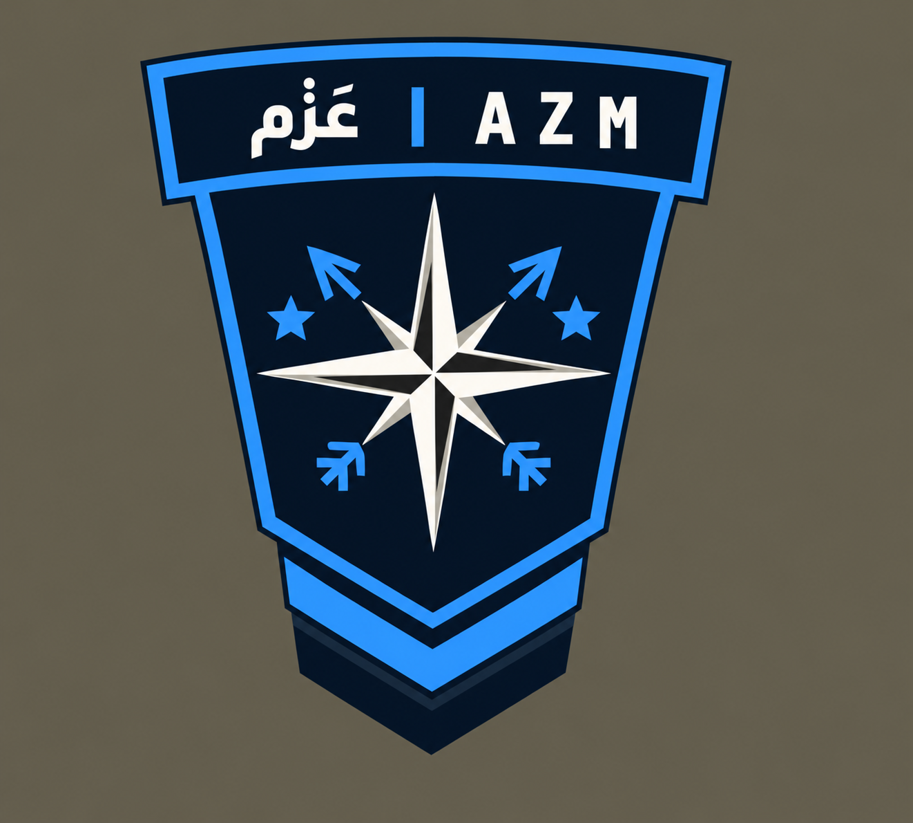
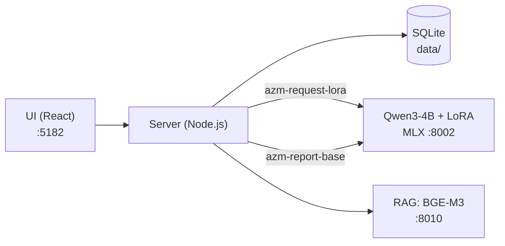

<div align="center">



# AZM | عَزْم

**A C4I system for military supply management and decision support, powered by Gen AI**

Users write supply requests in their own words. Gen AI turns them into structured requests that are approved and tracked, and the commander sees the full operational picture in one place.
Everything runs **locally** on a single machine, with no internet and no data sent to any outside service.

`Qwen3-4B` · `QLoRA Fine-tuning` · `RAG (BGE-M3)` · `MLX` · `Node.js` · `React` · `SQLite`

</div>

---

## Contents

1. [What it does, and for whom](#1-what-it-does-and-for-whom)
2. [Repository structure](#2-repository-structure)
3. [Installation and running, step by step](#3-installation-and-running-step-by-step)
4. [Architecture, model and data](#4-architecture-model-and-data)
5. [Results](#5-results)
6. [Tests](#6-tests)
7. [Data sources and licenses](#7-data-sources-and-licenses)
8. [Team](#8-team)

---

## 1. What it does, and for whom

**The problem.**
- Supply requests arrive as free text and phone calls, with no common format.
- Stock and request data are scattered across places.
- The commander has no live picture of the supply situation.
- Reports are written by hand.

**The solution.** AZM is the supply layer of a C4I system (Command, Control, Communications, Computers, Intelligence):

| Feature | What it provides |
|---|---|
| **Request extraction with Gen AI** | The user writes in plain Arabic or English, with or without a request verb, e.g. «بكرة ضروري، ديزل 4 براميل وللشاحنات كفر 20» or «ديزل 1000 لتر مويه 200 لتر». The fine-tuned model turns it into a structured request (JSON). The chat shows «تفاصيل طلبك» (your request details) and asks for anything missing. After «تمام» (OK), it opens the request form already filled in. |
| **AI assistant** | Answers questions from live system data through read-only tools and RAG, within each user's permissions, and checks every number in its reply. Identity, coordinates and simple unit-stock questions («كم الديزل عندنا؟», "how much diesel do we have?") are answered directly by the server from the data. |
| **Operational report** | The server computes the figures; Gen AI writes the summary, observations and recommendations; the report is exported as a PDF with a unified template. |
| **Common operational picture** | A tactical map of bases, supply points and units, with stock levels, moving convoys, and low-stock alerts. |
| **Request cycle and permissions** | Submit, approve, issue from the depot, track, deliver. Three roles, with every permission enforced on the server. |

**Who uses it**

| Role | Sees and does |
|---|---|
| Commander (`admin`) | Every base; approves requests and sets priorities; manages accounts and the catalog |
| Base manager (`base_manager`) | Their base, its supply points and units; approves and issues from their depots |
| Unit manager (`user`) | Their own unit only; submits and follows requests |

---

## 2. Repository structure

```text
AZM/
├── README.md                ← this file
├── server.mjs               ← server entry point
├── start-azm.cmd            ← run the site (Windows)
├── start-azm.sh             ← run the site (Mac / Linux)
├── .env.example             ← every setting, with an explanation
├── index.html               ← UI entry page
├── src/                     ← UI (React + JSX, no build step)
│   ├── assistant/           ←   AI assistant and the chat request draft
│   ├── reports/             ←   reports and the unified PDF template
│   ├── requests/            ←   supply requests
│   ├── map/                 ←   tactical map
│   └── ...
├── server/                  ← server (Node.js, no external packages)
│   ├── ai/                  ←   prompts, tools, guardrails, model and RAG calls
│   │   ├── request-contract.mjs ← JSON contract for extraction, and its validation
│   │   ├── request-evidence.mjs ← evidence guards: every item, quantity and deadline must appear in the text
│   │   └── stock-direct.mjs  ← unit-manager stock answers straight from the unit's data
│   ├── routes/              ←   API endpoints
│   ├── store/               ←   storage (SQLite) and permissions
│   └── lib/                 ←   shared helpers
├── scripts/                 ← model runtime, project tools, tests
│   ├── serve-mlx.py         ←   model server (Qwen3-4B + LoRA), OpenAI-compatible API
│   ├── setup-ai.sh          ←   one-time model environment setup and download (Mac and Linux/WSL)
│   ├── start-ai.sh          ←   run the model on port 8002
│   ├── start-rag.sh         ←   run the RAG service on port 8010
│   ├── eval-extraction.mjs  ←   extraction evaluation on 200 examples (base vs fine-tuned, and after guardrails)
│   └── *-test.mjs / *.py    ←   tests
├── rag/                     ← RAG service (BGE-M3) and its test
├── resources/               ← item catalog and the RAG knowledge base
├── training/                ← LoRA training: settings and command
│   └── data/                ←   train.jsonl (1600) and valid.jsonl (200), exactly as trained
├── eval-results/report.md   ← evaluation result (fine-tuned vs base, and after guardrails)
├── docs/                    ← detailed documentation (Arabic)
├── branding/                ← logo
└── vendor/                  ← React, Leaflet and Babel, stored locally
```

> **Not in the repository on purpose:**
> - `data/`: accounts and live operational data. Created automatically on first run.
> - `models/`: the LoRA adapter (59MB). Download it from the **Releases** page.
> - `.env`: local settings.

---

## 3. Installation and running, step by step

The project has **3 parts**. Each one runs in its own window.

| Part | Role | Needs |
|---|---|---|
| **Site** (UI + server) | The system itself | Node.js only |
| **Model** (Qwen3-4B + QLoRA) | Request extraction, AI assistant, reports | Python + MLX + a suitable GPU |
| **RAG** (BGE-M3) | Knowledge retrieval for the assistant and reports | Python + PyTorch |

> **The site alone runs on any machine.** Without the model, the assistant and AI reports show "unavailable" and everything else works. Without RAG, the server falls back to a local search.

### 3.1 Can my machine run it?

| Machine | Site | Model | RAG |
|---|:---:|:---:|:---:|
| **Mac** with Apple Silicon (M1 or later) | ✅ | ✅ natively | ✅ |
| **Windows** with an **NVIDIA** GPU (8GB VRAM or more) | ✅ | ✅ inside WSL2 | ✅ inside WSL2 |
| **Linux** with an **NVIDIA** GPU (8GB VRAM or more) | ✅ | ✅ | ✅ |
| Windows without NVIDIA, or an Intel Mac | ✅ | ❌ | ✅ |

> **Why:**
> - The model runs on **MLX**.
> - MLX runs natively on Apple Silicon, and on Linux only with an NVIDIA GPU (CUDA).
> - On Windows, that Linux is WSL2.

**Recommended resources**

| | Minimum | Recommended |
|---|---|---|
| Mac (unified memory) | 8GB (without RAG) | 16GB |
| Windows / Linux | 8GB VRAM + 16GB RAM | 12GB VRAM + 16GB RAM |
| Disk space | 10GB (model 2.2GB, BGE-M3 2.3GB, CUDA environment ~4.4GB) | 15GB |

### 3.2 Software to install

| Software | Mac | Windows |
|---|---|---|
| **Git** | `xcode-select --install` | [git-scm.com](https://git-scm.com/download/win) |
| **Node.js 24.15 or later** | [nodejs.org](https://nodejs.org) or `brew install node` | [nodejs.org](https://nodejs.org) (Current release) |
| **Python 3.12** | `brew install python@3.12` | Inside WSL: included with Ubuntu 24.04 |
| **WSL2 + Ubuntu 24.04** | — | In PowerShell as administrator: `wsl --install -d Ubuntu-24.04`, then restart |
| **NVIDIA driver with WSL support** | — | Latest driver from [nvidia.com](https://www.nvidia.com/Download/index.aspx). Do not install a driver inside WSL |
| **python3-venv** | — | Inside Ubuntu: `sudo apt update && sudo apt install -y python3-venv python3-pip` |

**Check before you continue:**

```bash
node --version      # v24.15 or later
git --version
python3 --version   # 3.12.x  (Windows: inside Ubuntu)
nvidia-smi          # Windows only, inside Ubuntu: must show your GPU
```

### 3.3 Libraries (installed automatically)

You do not install libraries by hand; the scripts do it. For reference:

| Part | Libraries | Source |
|---|---|---|
| **Site** | Nothing to install (no `npm install`). React 18, Babel and Leaflet are in `vendor/` | — |
| **Model (Mac)** | `mlx` · `mlx-lm` (which bring `transformers` · `huggingface_hub` · `safetensors` · `sentencepiece` · `numpy`) | `scripts/requirements-mlx-mac.txt` |
| **Model (Windows/Linux)** | The same, plus `mlx-cuda-12` and the NVIDIA CUDA 12 libraries | `scripts/requirements-mlx.txt` |
| **RAG** | `torch` (CPU build) · `sentence-transformers` | `rag/requirements.txt` |

**Downloaded on first run:**

| File | Size | From |
|---|---|---|
| `mlx-community/Qwen3-4B-4bit` | ~2.2GB | Hugging Face, by the setup script |
| `BAAI/bge-m3` | ~2.3GB | Hugging Face, on the first RAG start |
| `request-adapter.zip` (LoRA) | 59MB | This repository's **Releases** page |

### 3.4 Running it

> **On Windows:**
> - Model and RAG commands go in an **Ubuntu** (WSL) window.
> - Site commands go in **CMD**.
> - A project at `C:\AZM` appears inside Ubuntu as `/mnt/c/AZM`.
> - Keep the project outside OneDrive; syncing can empty files while they are in use.

#### Step 1: Get the code

| Mac | Windows (CMD) |
|---|---|
| `git clone https://github.com/Alishaya09/azm.git ~/AZM` | `git clone https://github.com/Alishaya09/azm.git C:\AZM` |

#### Step 2: Get the LoRA adapter

Download `request-adapter.zip` from **Releases** and unzip it **in the project root**. The zip already contains the `models/request-adapter/` folder, so you end up with:

```text
AZM/models/request-adapter/adapters.safetensors
AZM/models/request-adapter/adapter_config.json
```

#### Step 3: Set up the model (once)

| Mac (Terminal) | Windows (Ubuntu) |
|---|---|
| `cd ~/AZM`<br>`bash scripts/setup-ai.sh` | `cd /mnt/c/AZM`<br>`bash scripts/setup-ai.sh` |

The script:
- detects your machine;
- creates a Python environment in `~/azm-llm/venv`;
- installs the libraries;
- downloads the model.

The last line must be `MLX OK`.

#### Step 4: Start the three parts (3 windows)

| | Mac (3 Terminal windows) | Windows | Check |
|---|---|---|---|
| **1. Model** | `cd ~/AZM`<br>`bash scripts/start-ai.sh` | **Ubuntu** window:<br>`cd /mnt/c/AZM`<br>`AZM_MAX_CONTEXT=7168 AZM_PROMPT_CACHE_SLOTS=1 bash scripts/start-ai.sh` | http://127.0.0.1:8002/v1/models |
| **2. RAG** | `cd ~/AZM`<br>`bash scripts/start-rag.sh` | Second **Ubuntu** window:<br>`cd /mnt/c/AZM`<br>`bash scripts/start-rag.sh` | http://127.0.0.1:8010/health |
| **3. Site** | `cd ~/AZM`<br>`bash start-azm.sh` | **CMD** window:<br>`cd /d C:\AZM`<br>`start-azm.cmd` | http://127.0.0.1:5182 |

> - Wait until the model says it is ready before using the assistant.
> - The first RAG start takes a while: it downloads BGE-M3 and builds the index.
> - On an 8GB GPU, use `AZM_MAX_CONTEXT=7168 AZM_PROMPT_CACHE_SLOTS=1` as shown. With more memory you can drop them.

#### Step 5: First sign-in

- **Admin account:** on first run the server creates the admin account. It prints the password in the site window and in `data/FIRST_RUN_CREDENTIALS.txt`. **Delete that file after reading it.**
- **Choosing your own password:** run `node scripts/setup.mjs` before the first start.
- **Other accounts:** after signing in, create base-manager and unit-manager accounts from the Users page.

#### To stop

`Ctrl + C` in each window.

### 3.5 Settings

Settings live in `start-azm.cmd` (Windows) and `start-azm.sh` (Mac/Linux). Every variable is explained in `.env.example`.

| Variable | Value | Meaning |
|---|---|---|
| `PORT` | `5182` | Site port |
| `AZM_AI_BASE_URL` | `http://127.0.0.1:8002/v1` | Model server |
| `AZM_RAG_URL` | `http://127.0.0.1:8010` | RAG service |
| `AZM_AI_TEMPERATURE` | `0` | Assistant temperature |
| `AZM_REPORT_AI_TEMPERATURE` | `0` | Report temperature |
| `AZM_AI_MAX_TOKENS` | `512` | Maximum reply length |

> Extraction temperature is fixed at `0` in `server/config.mjs`.

### 3.6 Troubleshooting

| Problem | Fix |
|---|---|
| Assistant says "unavailable" | The model window is not running or not ready yet. Open http://127.0.0.1:8002/v1/models |
| `nvidia-smi: command not found` inside Ubuntu | Install the latest NVIDIA driver on Windows itself, then restart |
| `out of memory` in the model window | Use `AZM_MAX_CONTEXT=7168 AZM_PROMPT_CACHE_SLOTS=1` and close other GPU-heavy programs |
| Adapter not found (`الأدابتر غير موجود`) | Step 2: check `models/request-adapter/adapters.safetensors` |
| Port 5182 in use | Windows: `netstat -ano \| findstr :5182`, then `taskkill /F /PID <pid>`<br>Mac: `lsof -i :5182`, then `kill <pid>` |
| `BrokenPipe` in the RAG window | Harmless; the service keeps working |
| `node` says the version is too old | Install Node.js 24.15 or later |

---

## 4. Architecture, model and data

### Architecture



**Two separate paths:**

- **Request path:**
  1. The user writes a request.
  2. The fine-tuned model extracts it (`azm-request-lora`, temperature 0).
  3. The server applies the guardrails.
  4. The chat shows «تفاصيل طلبك», then opens the request form.
  5. The commander approves and the request is executed.
- **Assistant path:**
  1. The user asks a question.
  2. The assistant picks a read tool.
  3. RAG retrieves knowledge.
  4. Gen AI writes the answer (`azm-report-base`).
  5. The server checks every number.

**One model, two names.** A single process on port 8002 serves both names:
- `azm-request-lora`: the adapter is on.
- `azm-report-base`: adapter scale is 0.

This is what makes an 8GB machine enough.

### Model

| | |
|---|---|
| **Base model** | Qwen3-4B, 4-bit quantized (`mlx-community/Qwen3-4B-4bit`) |
| **Runtime** | MLX: natively on Apple Silicon, or CUDA on Linux/WSL (`scripts/serve-mlx.py`), with an OpenAI-compatible API |
| **Fine-tuning** | QLoRA (LoRA on the 4-bit quantized model): rank 16, scale 2.0, dropout 0.05, 16 layers, 800 iterations, batch 4, LR 1e-4, max seq 1024, `mask_prompt`, seed 42 ([training/README.md](training/README.md)) |
| **Adapter size** | 59MB |
| **Embedding model (RAG)** | BGE-M3 (~568M parameters, 1024 dimensions), on CPU so the GPU stays free for the model |

**Extraction output format**

```json
{
  "items": [
    { "item": "diesel", "supply_class": "III", "quantity": 4, "unit_of_measure": "barrel" },
    { "item": "truck tire", "supply_class": "IX", "quantity": 20, "unit_of_measure": "piece" }
  ],
  "priority": "urgent",
  "deadline": "tomorrow"
}
```

**Guardrails** run after the model: the model proposes, the server decides.

| Guardrail | Example |
|---|---|
| Supply class comes from the catalog, not the model | Diesel is always `III` |
| Unit conversion | 12 barrels become 2400 liters |
| A negated item is removed | «نبي ماء وما نبي تمر» (water yes, dates no) |
| "Not urgent" never becomes urgent | `urgent` becomes `normal` |
| Quantity without a unit gets the base unit, shown explicitly | «بنزين 500» becomes "500 liters"; the user can change it |
| A unit written after the number overrides the model's unit | «مويه 200 لتر» and the model said pallet: 200 liters |
| **Evidence guards** (`request-evidence.mjs`): every item, quantity and deadline must appear in the user's text | «شوالات رمل وعدد (25) كشاف»: if the model gives the 25 to the sandbags, the server clears it and asks |
| A quantity must be written in the text | «زيت مكينه 200» and the model said 20: the quantity is asked |
| A unit not allowed for the item does not reject the whole request | «25 كيس رمل»: `bag` becomes piece, the sandbag's only unit. An item with several units is asked about instead of a guessed conversion |
| An item name outside the catalog is matched from the user's text | The item mentioned in the text is added without a quantity and asked about. Nothing the user asked for is dropped silently |
| Missing fields are asked about, never invented | Item without a quantity: the chat asks for it |

Rule: guardrails **never invent a value**. Any doubt becomes a question to the user before the request is sent.

### Prompt engineering

| Use | Prompt parts |
|---|---|
| **Extraction** | Short prompt + JSON schema, **identical to the training prompt** (any change weakens the LoRA; a longer prompt used to break the JSON format) |
| **Assistant** | 6-section system prompt + a live data snapshot scoped to the user's permissions + 3 RAG passages + account info + chat history |
| **Report** | Server-computed figures + 4 RAG passages; Gen AI writes only the summary, observations and recommendations |

**Accuracy safeguards**
- **Read-only tools:** `read_inventory`, `read_requests`, `read_locations`, `read_users`.
- **Number verification:** every number in a reply is checked against the data.
- **Commander guardrail:** if the model wrongly refuses a commander's question, it is asked once more. If it refuses again, the reply says the information is not available instead of refusing.
- **Fixed answers from the server:** identity, coordinates, and unit-manager stock questions.

**Performance on 8GB**
- **Prompt cache:** reuses the fixed part of the prompt (~2,000 tokens).
- **Prefill step 256:** lowers peak memory.
- **Context window:** 7,168 tokens.
- **Snapshot compaction:** shrinks live data to fit the context.

### Data

| Data | Source | Location |
|---|---|---|
| **Training data** | Supply-request → JSON examples prepared by the team: 1600 train + 200 validation (used for evaluation); 75% Arabic, 25% English | `training/data/` |
| **Item catalog** | 40 items with class, units and consumption rates | `resources/items.json` |
| **RAG knowledge base** | 14 passages on AZM's supply methodology | `resources/report-knowledge.json` |
| **Operational data** | Created at runtime (demo data), **never committed** | `data/` |

---

## 5. Results

### Request extraction: base vs fine-tuned

On **200 examples the model never trained on** (`training/data/valid.jsonl`), temperature 0, same prompt as the server (`node scripts/eval-extraction.mjs`). Full report: [eval-results/report.md](eval-results/report.md).

| Metric | Base model (Qwen3-4B) | Fine-tuned (LoRA) |
|---|---:|---:|
| **Exact match (whole request)** | 4.0% | **95.5%** |
| Supply class `supply_class` | 48.3% | **99.4%** |
| Unit `unit_of_measure` | 63.6% | **98.0%** |
| Deadline `deadline` | 58.0% | **99.5%** |
| Priority `priority` | 72.0% | **99.5%** |
| Quantity `quantity` | 94.0% | **98.3%** |
| Valid JSON | 100% | 100% |
| Average response time | 1.4 s | 1.2 s |

During training, the held-out test split (200 requests, not in this repository) gave 4.5% → 94.5% exact match, and 80% on 30 harder requests.

The base model reads the numbers in the text but does not know AZM's rules: supply classes, allowed units, and writing `null` instead of guessing. That is what fine-tuning taught it.

### After the server guardrails

Only 9 errors out of 200; 6 of them were requests that mix items with and without a quantity. The evidence guards catch them without retraining (`node scripts/eval-extraction.mjs --guards`).

| | Model alone | With guardrails |
|---|---:|---:|
| Correct request passes directly | 95.5% | **96.5%** |
| Error caught: the server asked the user or rejected | — | 3.5% |
| **Error that passes unnoticed** | 4.5% | **0.0%** |
| Correct request wrongly stopped by the guardrails | — | **0 of 200**, and **0 of 1800** (all training and validation examples, `request-evidence-test.mjs`) |

The guardrails also protect the base model: errors that pass unnoticed fall from 96% to 9%. Fine-tuning and guardrails work together.

### Running on an 8GB machine

| Metric | Result |
|---|---|
| Peak GPU memory after prefill step 256 (8GB NVIDIA GPU) | **6.8GB → 3.5GB** (about 48% lower) |
| Context window | **7,168** tokens |
| Adapter size | **59MB** instead of a full copy of the model |
| Offline | **100%**: model, RAG and data are all local |

> **Limits of the measurement:**
> - The evaluation examples share the style of the training data, so the result measures how well the task was learned.
> - It does not guarantee the same accuracy for every real-world phrasing.
> - That is why the guardrails, and the user's review step («تفاصيل طلبك» then «تمام»), are part of the design.

---

## 6. Tests

```bash
node scripts/check.mjs                    # code integrity checks
node scripts/smoke-test.mjs               # full server test on temporary data (never touches data/)
node scripts/request-evidence-test.mjs    # extraction guardrails + no false stops on 1800 correct examples
node scripts/stock-direct-test.mjs        # unit-manager stock answers
node scripts/eval-extraction.mjs --guards # real-model evaluation (needs the model server on 8002)
```

More tests are in `scripts/*-test.mjs` (chat intent, request extraction, report template, …). They all use temporary data and a mock model (`scripts/mock-llm.mjs`).

**More detail (Arabic):**
- [docs/SETUP.md](docs/SETUP.md): full setup and troubleshooting;
- [docs/FEATURES.md](docs/FEATURES.md): features and roles;
- [docs/AI_INTEGRATION.md](docs/AI_INTEGRATION.md): how the AI is wired in;
- [training/README.md](training/README.md): training;
- [eval-results/report.md](eval-results/report.md): the evaluation report.

---

## 7. Data sources and licenses

| Component | License |
|---|---|
| [Qwen3-4B](https://huggingface.co/Qwen/Qwen3-4B) | Apache 2.0 |
| [BGE-M3](https://huggingface.co/BAAI/bge-m3) | MIT |
| [MLX](https://github.com/ml-explore/mlx) / [mlx-lm](https://github.com/ml-explore/mlx-lm) | MIT |
| [sentence-transformers](https://github.com/UKPLab/sentence-transformers) | Apache 2.0 |
| React 18 / Babel Standalone | MIT |
| Leaflet 1.9.4 | BSD-2-Clause |
| Map imagery: Esri, CARTO, © OpenStreetMap contributors | Each provider's terms (OSM: ODbL) |
| Road routing: OSRM | BSD-2-Clause (public demo server only) |

- The training data, catalog and knowledge base were **prepared by the team** for this project. They contain no real military data.
- All data and scenarios in the system are **for demonstration**.

---

## 8. Team

| Member | Role |
|---|---|
| **Badr Al-Dyhani** | Data preparation · QLoRA fine-tuning |
| **Ali Al-Masar** | Prompt engineering · UI development |
| **Abdullah Al-Enezi** | Source code (system development) · RAG (BGE-M3) |

**Shared by the whole team:**
- evaluation and continuous improvement;
- C4I system design;
- server integration and guardrails;
- testing and model evaluation;
- documentation and the final presentation.

<div align="center">
<sub>Tuwaiq Academy · أكاديمية طويق</sub>
</div>
